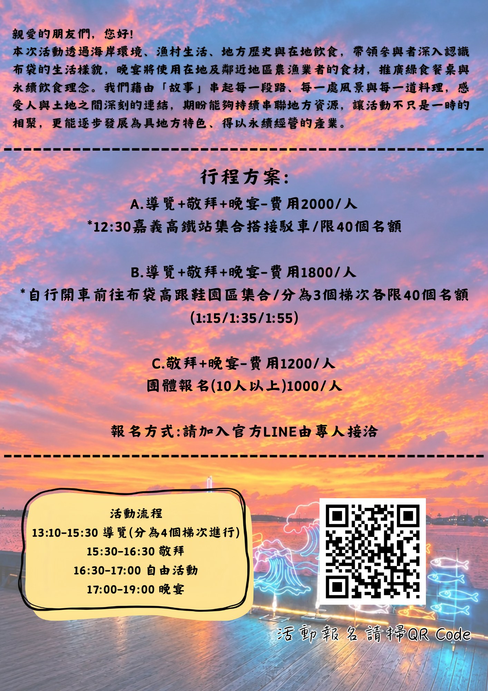

走一段海岸，聽一段漁村的故事，再坐下來吃一桌用在地食材做的晚宴。11 月 21 日這個週六，邀請你來布袋，認識這片海和這裡的人。

| | |
| :--- | :--- |
| **時間** | 2026/11/21（六）13:00–19:00 |
| **地點** | 嘉義縣布袋鎮 |
| **主辦** | 社團法人台灣西海岸發展協會 |

## 活動流程

| 時間 | 內容 |
| :--- | :--- |
| 13:10–15:30 | 導覽（分 4 梯次進行） |
| 15:30–16:30 | 敬拜 |
| 16:30–17:00 | 自由活動 |
| 17:00–19:00 | 晚宴 |

晚宴使用在地及鄰近農漁業者的食材，推廣綠食餐桌與永續飲食。

## 行程方案

**A｜導覽＋敬拜＋晚宴　2,000 元／人** 
12:30 嘉義高鐵站集合，搭接駁車前往（限 40 名）

**B｜導覽＋敬拜＋晚宴　1,800 元／人** 
自行開車至布袋高跟鞋園區集合，分 1:15／1:35／1:55 三梯次（各限 40 名）

**C｜敬拜＋晚宴　1,200 元／人** 
團體報名（10 人以上）每人 1,000 元

## 報名方式

請加入官方 LINE，由專人為您接洽報名 👉 **[加入官方 LINE](https://line.me/R/ti/p/@397kcgep)**

名額有限，歡迎揪親友一起來！

